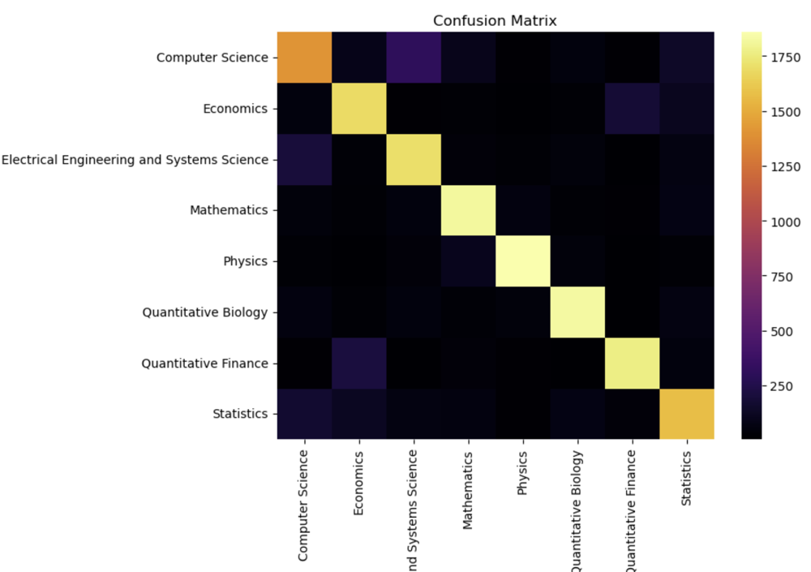

# arXiv Paper Classifier

This project predicts an arXiv paper's field (Computer Science, Mathematics, Physics, …) from its title and abstract alone. The pipeline uses classical text classification at the scale of the whole arXiv: 2.47 million papers. It feeds TF-IDF features to Naive Bayes, KNN and a linear SVM, each tuned with cross-validated grid search.

This was my final project for ECE 753, Pattern Recognition and Neural Networks, at the University of Miami, 2024. I did it solo.

## Results

**Balanced subset, 8 classes.** There are 6,980 papers per field, so 55,840 in total, with a 70/30 stratified split. The test set has 16,752 papers.

| Model | Best hyper-parameters (5-fold CV) | Test accuracy | Macro-F1 |
|---|---|---:|---:|
| Multinomial Naive Bayes | α = 0.04 | 0.80 | 0.80 |
| KNN (Euclidean, distance-weighted) | k = 111 | 0.76 | 0.76 |
| **LinearSVC** | **C = 0.3** | **0.82** | **0.82** |

Per-field F1 for the SVM: Physics 0.91, q-bio 0.87, q-fin 0.87, Mathematics 0.86, Economics 0.80, EESS 0.80, Statistics 0.73, Computer Science 0.70. The confusions are the ones you'd expect: CS ↔ EESS, Economics ↔ Quantitative Finance, and Statistics with everything.

<p align="center">
  
</p>

**Balanced subset, 20 classes.** Physics is split into its sub-archives, giving 139,600 papers. Naive Bayes reaches 0.76 test accuracy, KNN 0.68 and LinearSVC 0.77.

**Full dataset, 8 classes, Naive Bayes.** On the full dataset, accuracy is the wrong metric. Physics alone is 54% of arXiv and Economics is 0.3%. Naive Bayes reaches **0.89 accuracy but only 0.65 macro-F1** on a 740,520-paper test set, and Economics gets an F1 of 0.23 ([output](docs/full_dataset_naive_bayes_report.png)). The imbalance, together with memory limits for KNN and SVM at this scale, is why the models are compared on a balanced subset.

## Approach

1. **Labels.** Each paper's *first* listed category is its primary one. 18 legacy archives (e.g. `supr-con`) are remapped to their modern names, then every category is mapped to one of 8 top-level groups: CS, Economics, EESS, Mathematics, Physics, q-bio, q-fin and Statistics.
2. **Text.** Title and abstract are concatenated and lowercased. Bracketed text and non-alphanumerics are stripped, and NLTK stopwords are removed. The text is then stemmed with Porter (1 h 12 min on the full corpus) or lemmatized with spaCy (20 h).
3. **Features.** TF-IDF with unigrams, a vocabulary of 165,846 terms on the balanced subset and 2.5 million on the full corpus.
4. **Models.** `MultinomialNB`, `KNeighborsClassifier` and `LinearSVC` (one-vs-rest), each tuned with `GridSearchCV(cv=5)`.
5. **Dimensionality reduction.** I also tried TruncatedSVD with 13,000 components, which captured 85.8% of the variance before running out of memory. It didn't improve the SVM (0.82) and made KNN worse (0.69).

## Notebooks

| | |
|---|---|
| [`01_preprocessing`](notebooks/01_preprocessing.ipynb) | Loading, label mapping, cleaning, stemming and lemmatization |
| [`02_balanced_8_classes`](notebooks/02_balanced_8_classes.ipynb) | The main experiment: NB, KNN and SVM on the balanced 8-class subset |
| [`03_balanced_20_classes`](notebooks/03_balanced_20_classes.ipynb) | The same, with Physics split into 13 sub-fields |
| [`04_lemmatized_and_svd`](notebooks/04_lemmatized_and_svd.ipynb) | Lemmatized text and the TruncatedSVD experiment |
| [`05_full_dataset_naive_bayes`](notebooks/05_full_dataset_naive_bayes.ipynb) | An early full-dataset Naive Bayes run |

The outputs are kept from the original runs. The [report](report/final_report.pdf) and [slides](report/presentation.pptx) are as submitted. The report's text says the SVM used an RBF kernel, but the implementation is a `LinearSVC`.

## Running it

```bash
pip install -r requirements.txt
python -m spacy download en_core_web_sm
# download arxiv-metadata-oai-snapshot.json into data/ (see data/README.md)
jupyter notebook notebooks/
```

Run `01` first: it writes the cleaned CSVs that the other notebooks read. The full dataset needs a lot of RAM. On the original machine, TF-IDF on 2.4M abstracts plus KNN or SVM grid search ran into `MemoryError` and needed disk-backed swap.

## What I'd do differently

- Use **macro-F1 and class weights** from the start, instead of discovering the imbalance problem through accuracy.
- Use **bigrams and `min_df`** to cut the 2.5M-term vocabulary to something an SVM can train on in minutes, and drop SVD.
- Fine-tune a **transformer** such as SciBERT on a balanced subset. That is the obvious next baseline, and an arXiv abstract fits comfortably in its context window.
